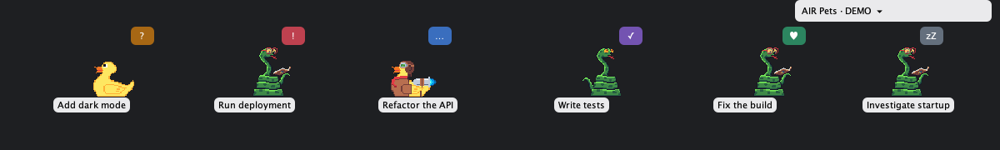

# Air Pets

Animated companions for your [Air](https://plugins.jetbrains.com/plugin/33314-air/edit) agent sessions in JetBrains IDEs.

Each session gets a pet that moves while the agent works, asks for attention when it needs input, and celebrates a result. Click the pet to read the conversation and reply without opening the Air tool window.



*Rendered demo preview, not a live Air session.*

## What it does

- **Shows session activity.** Different animations and badges distinguish working, waiting, review, resting, completed, and error states.
- **Keeps conversations close.** Quick Chat uses Air's native conversation and reply composer. Open the full session in Air whenever you need it.
- **Adds context on hover.** A card shows the session name, state, workspace, and worktree branch when available.
- **Offers optional metrics.** Show Air-reported cost and locally observed working time beneath each pet.
- **Stays out of the way.** Drag pets aside, turn off animation, or hide the overlay. Empty space around the pets passes clicks through to the IDE.

Companions include cats, dogs, Clippy, Kodee, Runzo, green snakes, and yellow rubber ducks. Species are assigned automatically and stay the same when a session's name or status changes; there is no species picker.

## Requirements

- IntelliJ IDEA **2026.2**, build **262.8665** or newer. The build targets **2026.2.3**.
- The **Air plugin**, installed and enabled. The integration is compiled against Air **262.8665.497**.

## Using Air Pets

| Action | Control |
| --- | --- |
| Open Quick Chat | Click a live pet or its visible name |
| See session details | Hover over a pet briefly |
| Move a pet | Drag it anywhere inside the IDE frame |
| Archive a completed session | Hover its green `♥` badge, then click the `✓`; or choose **Mark as done** in its hover card |
| Open preferences and the session list | Click **Pets** beside the Air icon in the bottom-right status bar, or right-click a pet |
| Hide or restore the overlay | **Tools → Air Pets → Show Air Pets** |

**Mark as done** uses Air's per-session archive action. It does not stop an agent or approve a review. The pet disappears after Air confirms the session is archived.

The status-bar menu stays available even when pets are hidden or there are no sessions. It includes **All sessions** navigation and toggles for animation, hover names, cost, time, and demo mode. If the widget is missing, enable **Air Pets** in the status bar's context menu.

Turn off **Animate pets** for reduced motion. Visibility, animation, name, cost, and time preferences are saved per project. Demo mode and dragged positions are not saved across restarts. Turning off **Show session names on hover** also replaces the hover card's title with **Air session**.

### Quick Chat

Quick Chat is movable and resizable. It takes keyboard focus so you can type a reply; pets and hover cards do not. Press **Escape** or click outside to close it, or choose **Open in Air** for the full session view. Unsupported sessions offer the full Air view instead of an embedded conversation.

Reopening a pet preserves its unsent text and attachments in memory while the project remains open. The plugin does not save those drafts across project closure or IDE restarts, and removes the cached composer when the session is removed or archived. Quick Chat and the full Air view have separate composers whose drafts are not live-synchronized; avoid editing both at once.

Opening Quick Chat does not start a new session or send a prompt. Sending a reply or responding to Air's native controls can continue agent execution and incur normal Air costs.

### Session states

| State | Badge | Pet behavior |
| --- | --- | --- |
| Working | Blue `…` | Runs or plays its working animation while moving |
| Needs your input | Amber `?` | Bobs for attention; also covers sessions waiting on a predecessor |
| Ready for review | Purple `✓` | Walks slowly |
| Ready / paused | Gray `zZ` | Rests on a still frame |
| Completed | Green `♥` | Celebrates a result |
| Stopped with an error | Red `!` | Bobs for attention |

Active work, input requests, and review take precedence over older completion or error signals. Air's frontend does not distinguish ready from every paused state. Likewise, an unread result or completion signal is not proof that the task's outcome has been accepted.

### Cost and working time

**Show session cost** and **Show session time** are independent options, both off by default. When enabled, they appear beneath the pet and in its hover card, for example `≈$0.42 · 1m 23s`.

- **Cost** comes from Air in USD. `≈` marks an estimate, small positive amounts show `<$0.01`, and unavailable costs are omitted rather than shown as zero.
- **Time** counts only work observed during the current project opening, not the session's historical duration. It pauses outside the working state or when disconnected and resets when the project closes. Tracking continues while pets are hidden or animation is off; sessions not yet observed working have no time value.

Demo costs and times are fictional.

## Scope and limitations

- Only non-archived sessions from the current project's Air workspace and its worktrees are shown. Opening a worktree as its own project shows only that worktree's sessions.
- The overlay shows at most **12 pets**, fewer if space is limited, and prioritizes requests for attention. The status-bar count and **All sessions** menu include sessions beyond that limit.
- The prototype supports ordinary local project frames. Detached editor windows, remote development, sounds, and direct start/stop/pause controls are not implemented.
- If Air discovery fails, live pets disappear while the plugin retries. The status-bar tooltip and menu report the connection problem; demo mode remains available.
- Air Pets adds no independent network client or telemetry and bundles its artwork locally. Session discovery and Quick Chat use Air's APIs; Air remains responsible for agent execution, storage, and network access. Quick Chat is not an offline or read-only view.

## Development

Use **JDK 25**; the build requests a Java 25 compilation toolchain.

**Local build prerequisite:** `settings.gradle.kts` currently includes a machine-specific checkout of the IntelliJ Platform Gradle Plugin. Point its `includeBuild(...)` path at your own checkout before running Gradle. The commands below assume that composite build is available.

```bash
# Launch a sandbox IDE with Air and Air Pets
./gradlew runIde

# Launch with fictional sessions; open a project to see the pets
./gradlew runIde -PairPetsDemo=true

# Run tests and package the plugin
./gradlew test buildPlugin verifyPluginStructure
```

Tests cover session discovery and worktree isolation, state mapping, navigation and archiving, Quick Chat, metrics, rendering, dragging, and click-through behavior. Rendering tests write previews to `build/reports/air-pets/`, including `demo.png` and light/dark mascot galleries at 100% and 200% scale.

For implementation details and prior validation, see [Air API research](docs/air-api-research.md) and [verification notes](docs/verification.md). The verification notes distinguish automated fixtures from live-agent testing.
