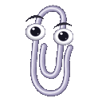

# Mascot artwork

Prepared from the owner-supplied artwork and visual reference on 2026-10-21. Mascot assets are bundled locally; the plugin does not download images at runtime. The existing snake/duck licensing research remains in [pet-art-research.md](pet-art-research.md). None of these mascots inherits the snake/duck MIT license.

## Kodee

**Kodee by JetBrains s.r.o. is licensed under CC BY 4.0.** Primary attribution and licensing evidence: [Kotlin Foundation brand guidelines, section IV](https://kotlinfoundation.org/guidelines). Original asset bundle: [Kotlin brand assets](https://kotlinlang.org/docs/kotlin-brand-assets.html). License: <https://creativecommons.org/licenses/by/4.0/>. Attribution is included in the packaged `pets/THIRD-PARTY-NOTICES.txt`; no endorsement is implied.

The supplied `kotlin_mascot_2 2/Digital/Emoji` GIFs are copied byte-for-byte, changing only their resource filenames. Their 128×128 canvas, transparency, timing, frame disposal, and loops are preserved. Rendering scales/mirrors them without changing their colors or proportions.

| Source | Bundled resource | State | Frames | Loop duration |
| --- | --- | --- | --- | --- |
| `kodee-floating.gif` | `pets/kodee/idle.gif` | Resting (frozen first frame), error | 51 | 2040 ms |
| `kodee-walking.gif` | `pets/kodee/walk.gif` | Review | 23 | 920 ms |
| `kodee-loading.gif` | `pets/kodee/run.gif` | Working | 49 | 2450 ms |
| `kodee-greetings.gif` | `pets/kodee/waiting.gif` | Needs input | 25 | 1000 ms |
| `kodee-happy.gif` | `pets/kodee/done.gif` | Completed | 17 | 680 ms |

SHA-256 of bundled files:

```text
f52d80b3c73f32f46cef931d865033aa72f5aa946a05b95e5c28cb77c1fbcbd0  idle.gif
c0760f6cfdd5112d0dc75fea4143f3b9baf9db55a3a5d005446266fb05ac8ab9  walk.gif
e75cc29c13e0aaafd0a69974c1cf25a5e30736d4551401de4fd6cab257c6e155  run.gif
e68fcd6573ec8c70a446b6a0ad031f82a18b093bf478d40efe0e7d9dadf3482d  waiting.gif
52c0897b6d7423f2b88629d91320fb85b8738afaea6d6951d1fb39e6687d725b  done.gif
```

## Runzo

Prepared from the supplied `Copy of JetBrains_RunButton_2D_Poses.ai`, `Copy of JetBrains_RunButton_2D_Face.ai`, and `Copy of JetBrains_Characer Guide.pdf`. The guide calls the character **Runee**; the plugin uses the requested **Runzo** name. The Illustrator files contain PDF-compatible vectors, so no Illustrator installation is needed to prepare the assets.

The pose sheet has blank faces. `tools/prepare_runzo.py` combines the selected original poses with facial vector paths from the expression sheet, registered rigidly to the matching head edge. It removes only the artboard background, crops away labels/guidelines, and rasterizes with supersampling. Original colors, proportions, and opaque black head interiors are retained. The guide's bendy-limb and head-tilt constraints are respected; there is no limb stretching or hand-drawn substitute character.

The five GIFs have transparent 128×128 canvases, twelve frames each, infinite loops, a shared palette, and a stable sole baseline at pixel 118. Their **new gentle pose-rocking loops are not official animation cycles**, and walk/run are posed strides rather than alternating-foot gait cycles. Normal overlay wandering and completion bounce are applied in addition to the clips.

| Resource | Supplied pose (row, column, starting at 1) | Original expression | Loop duration |
| --- | --- | --- | --- |
| `pets/runzo/idle.gif` | Relaxed standing (1, 1) | Neutral | 1440 ms |
| `pets/runzo/walk.gif` | High forward step (1, 8) | Happy | 960 ms |
| `pets/runzo/run.gif` | Curled rear-leg running (2, 4) | Neutral | 600 ms |
| `pets/runzo/waiting.gif` | Hands on hips (1, 2) | Confident | 1680 ms |
| `pets/runzo/done.gif` | Arms raised/open (1, 6) | Happy | 1200 ms |

### Reproduce

Only asset preparation needs Python; neither the plugin nor its Gradle tests depend on it. The original source documents are not bundled. Use the owner-supplied directory containing the three named documents:

```bash
python3 -m venv build/pet-art-tools
build/pet-art-tools/bin/python -m pip install 'Pillow==13.0.0' 'PyMuPDF==2.0'
build/pet-art-tools/bin/python tools/prepare_runzo.py /path/to/Runzo --preview-dir build/reports/air-pets/runzo-art
```

The generator checks source topology, expression registration, transparent bounds, baseline, face visibility, frame timing, and loop seams. It verifies that source hashes are unchanged. Repeated generation produced byte-identical GIFs. Optional previews include an animated `preview.html`, `contact-sheet.png`, and `metadata.json` with source SHA-256 values, PDF metadata, guide text, crop coordinates, registration matrices, and per-frame output measurements.

**Rights limitation:** no license or redistribution grant was found in the supplied guide text or PDF metadata. This does not establish permission, and Runzo is not covered by the other pets' MIT or CC BY licenses. The owner must confirm authorization for the artwork and derived animation **before public redistribution**. The bundled notice records provenance without granting a license or implying endorsement.

## Clippy

A newly drawn, Clippy-inspired paperclip based on the supplied screenshot: a shaded silver/lavender wire loop, large eyes, and expressive eyebrows. The screenshot itself is not bundled or raster-cropped. `tools/prepare_clippy.py` draws curves and shaded eyes with Pillow, using 4× supersampling and a shared GIF palette. The surrounding paper/background is deliberately omitted to keep editor content visible. These are unofficial illustrations and animation loops, not Microsoft's Office assets.

All five transparent 128×128 clips have 24 distinct frames, infinite loops, and background-restoring disposal. Every frame retains at least a three-pixel transparent margin. Gentle flex, tilt, blinking, and gaze changes form seamless loops; the existing overlay provides wandering and state badges.

| Resource | Behavior | Loop duration |
| --- | --- | --- |
| `pets/clippy/idle.gif` | Gentle sway and glance; resting freezes the first frame | 2400 ms |
| `pets/clippy/walk.gif` | Slow rocking shuffle | 1680 ms |
| `pets/clippy/run.gif` | Forward lean and quicker springing motion | 960 ms |
| `pets/clippy/waiting.gif` | Questioning tilt and raised eyebrow | 2400 ms |
| `pets/clippy/done.gif` | Celebratory wink and golden sparkles | 1680 ms |



Reproduce with the Pillow environment above; no input artwork, font files, or network access is required:

```bash
build/pet-art-tools/bin/python tools/prepare_clippy.py --preview-dir build/reports/air-pets/clippy-art
```

The generator validates transparent bounds, frame uniqueness, timing, and loop seams. Optional output includes a light/dark contact sheet, animated preview, and metadata with SHA-256 hashes. Refresh the independent compositor references only after reviewing the resulting artwork, as described below.

**Character rights:** Clippy/Clippit is Microsoft's character. Drawing new artwork does not establish permission to use that character. No character-usage grant was supplied or verified; review the rights before public redistribution. The bundled notice does not imply endorsement or extend the other pets' licenses to this character.

## Cats and dogs

Original pixel-art companions drawn for Air Pets: a ginger striped cat with pointed ears and a curved tail, and a tan/brown floppy-eared dog with a blue collar. `tools/prepare_cat_dog.py` draws and animates them using Pillow without input artwork, external fonts, or network requests. No commercial Catset or CC BY-ND dog artwork is used; the earlier [external-artwork exclusions](pet-art-research.md) still apply to those third-party assets, not these new drawings.

Each pet has five transparent 64×64 GIFs with twelve frames, infinite loops, background-restoring disposal, and at least three transparent pixels around every frame. Both face right in the source; the overlay mirrors them for leftward movement and uses nearest-neighbor scaling.

| Clip | State | Loop duration |
| --- | --- | --- |
| `idle.gif` | Resting (frozen first frame), error | 1440 ms |
| `walk.gif` | Review | 1080 ms |
| `run.gif` | Working | 720 ms |
| `waiting.gif` | Needs input | 1440 ms |
| `done.gif` | Completed | 1080 ms |

Reproduce with the Pillow environment above:

```bash
build/pet-art-tools/bin/python tools/prepare_cat_dog.py --preview-dir build/reports/air-pets/cat-dog-art
```

The generator checks frame timing, transparency, bounds, and decoded output against the authored frames. Tests cover bundled clips, loop timing, state selection, frozen resting frames, assignment, and demo coverage. The existing galleries render both new species in every state at 100% and 200% zoom on light and dark backgrounds.

## Runtime integration and verification

- Species are assigned deterministically from the session identity across snake, rubber duck, Kodee, Runzo, Clippy, cat, and dog. Names, state changes, and metric updates do not change species. The eight-session demo includes all seven.
- Mascots use smooth image interpolation; existing pixel-art sprites retain nearest-neighbor rendering. All pets use the same 64 logical-pixel tile, movement, badge, hover-name, metrics, and drag interaction.
- Optional waiting/completion clips fall back to idle for the original snake and duck, preserving their appearance and animation. Cats and dogs have dedicated clips for these states. Missing mandatory idle/walk/run clips remain errors rather than silently hiding a broken bundle.
- Tests decode every bundled GIF, check each mascot frame has transparent space and visible artwork, compare every state's selected clip, and verify resting frames stay still. Overlay regressions cover dragging, click actions, names, metrics, and zoom.
- All **345** mascot frames are checked pixel-for-pixel against independent Pillow-composited SHA-256 references in `src/test/resources/pets/mascot-frames.properties`, with transparent RGB normalized to zero. Kodee intentionally rotates its face out of view in some original frames; no white-eye assumption is imposed. Tests never regenerate references. After an intentional, visually reviewed artwork change, regenerate with `build/pet-art-tools/bin/python tools/prepare_mascot_references.py`.
- `PetMascotGalleryTest` writes all states/species on light and dark backgrounds at 100% and 200% scale under `build/reports/air-pets/mascots-{light,dark}-{100,200}.png` for visual inspection.